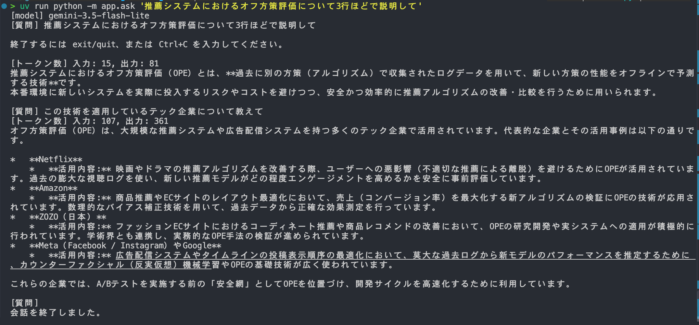

# 第1回 解答

## 演習

- 講座に固有の質問（宿題の3レベル）へのモデルの回答（要約でよい）
  - AIE2026（AIエンジニア育成講座などの2026年目標のプログラム）の宿題における「3レベル」という言葉は、受講生のスキルや理解度、あるいは課題の難易度に合わせて用意された3段階のステップを指している可能性が非常に高い。
- 用語集の正しい意味と比べて気づいたこと：レベル別の課題である旨はあっている。一方で、課題内容についての記述においては推測による一般論を述べているだけで、内容は全くあっていない。
- 表示できたトークン数（入力 / 出力）：21/473

## 宿題

- 取り組んだレベル：基礎
- やったこと：gemini-3.5-flash にモデルを変更し、同じ質問に対して temperature パラメータを1.0, 0.7, 0.3 と変更た。その違いについてまとめた。
  - 質問内容: 推薦システムにおけるオフ方策評価について3行で回答して
- 結果：
  - temperature = 1.0
    - 過去の行動ログデータを活用し、新しい推薦アルゴリズムの性能をA/Bテストなしで事前評価する手法です。実ユーザーに未検証の推薦を見せるリスクを避け、低コストかつ安全にモデルの比較や選別が行えます。
  - temperature = 0.7
    - 1. 過去の行動ログデータを用いて、新しい推薦アルゴリズムを実環境で動かさずに事前評価する手法です。
    - 2. ユーザー体験を損なうリスクを避け、安全・高速・低コストに複数モデルの比較検証が可能です。
    - 3. ログ特有のデータの偏り（選択バイアス）を傾向スコアなどで統計的に補正して正確な性能を推定します。
  - temperature = 0.3
    - 1. 過去の行動ログデータを活用し、新しい推薦アルゴリズムの性能をオンラインテストなしで事前評価する手法です。
    - 2. 実装に伴うユーザー体験の悪化リスクや検証コストを抑え、安全かつ迅速にモデルの効果を比較できます。
    - 3. 過去データ特有の偏り（バイアス）を補正するため、重要度サンプリングなどの統計的手法を用いて正確に予測します。過去データの偏り（バイアス）を補正するため、逆傾向スコア（IPS）などの統計的手法を用いて評価精度を高めます。
- 気づき・疑問：
  - 回答については各々合っている。
  - 一方、temperature パラメータが大きいほど、記述内容の自由度が高いように感じられ、分野を分かっている私にとって好ましい文章だと感じられた。

- 取り組んだレベル: 実装
- やったこと: `google.genai` の `client.chats.create()` メソッドを利用することで、会話履歴を保ったままユーザーが続けて質問を遅れるようにした。
- 結果:
  
- 気づき・疑問:
  - python 標準ライブラリの `readline` を import しておかないと、ターミナルの入力時に矢印キーが作動せず、UX が損なわれる。
